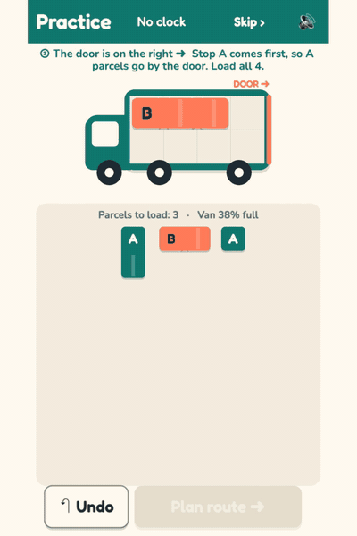

<div align="center">

# idea-to-launch

**Share a seed idea. Answer a few quick questions. Get a working MVP.**

[](LICENSE)
[](https://docs.claude.com/en/docs/claude-code)
[](https://github.com/moa0101/idea-to-launch/actions/workflows/ci.yml)
[](https://github.com/moa0101/idea-to-launch/releases)


[Install](#install) · [Real result](#a-real-run-vanful) · [How it works](#how-a-run-works) · [Level up](#level-up-from-it-works-to-it-sells) · [Troubleshooting](#when-something-goes-wrong) · [Updating](#updating)

</div>

---

A Claude Code plugin that works like a startup panel. It asks you at most 5 questions,
each with a recommended answer pre-selected, then decides everything else from evidence:
- runs a quick board verdict and competitor scan
- creates the brand: name, slogan, colours and an SVG logo
- writes a spec
- builds the product, runs it and tests it the way a user would

```
/idea-to-launch:launch a habit tracker for remote teams that posts streaks to Slack
```

(Installed by copying the skills instead of as a plugin? Then it's just `/launch …`. Or say "build my idea: …".)

## A real run: Vanful

<p align="center">
  <a href="https://vanful.vercel.app"></a>
</p>

**[Play it: vanful.vercel.app](https://vanful.vercel.app)**. One `/launch` run built v1 of this browser puzzle
game. Four `/launch-levelup` runs took it to a public launch kit. Every step is in
[`examples/vanful`](examples/vanful), including the challenge, plan and scorecard for each version.

| version | made by | what changed | ladder |
| --- | --- | --- | --- |
| v1 | `/launch` | playable game, brand, spec, unit tests | Works |
| v2 | `/launch-levelup` | guided first delivery, Lighthouse 100, Playwright e2e on desktop + phone | → Credible |
| v3 | `/launch-levelup` | Daily Load mode, supporter pack, email capture, pricing | → Sellable (provisional) |
| v4 | `/launch-levelup` | cross-player analytics + feedback on a real database, with permission tests | toward Fundable |
| v5 | `/launch-levelup` | itch.io / CrazyGames / Poki builds, covers, videos, rule-checked launch posts | public launch |

Scores and evidence: [`examples/vanful/launch/levels`](examples/vanful/launch/levels). It's pre-launch: no
player numbers yet, and none are claimed.

| platform | stack it builds | how it verifies |
| --- | --- | --- |
| Web app / SaaS | Next.js, Tailwind + shadcn/ui, Supabase (auth, Postgres, row-level security), Stripe test mode if paid | browser preview + Playwright |
| iOS / macOS app | SwiftUI, SwiftData, XcodeGen | iOS Simulator / built `.app` + XCTest |
| Web game | Vite, TypeScript, Phaser 3 | plays it in the browser |
| iOS / Mac game | SpriteKit in SwiftUI | plays it in the Simulator |

## Install

In Claude Code:

```
/plugin marketplace add moa0101/idea-to-launch
/plugin install idea-to-launch@idea-to-launch
```

Or copy the skills in by hand:

```bash
git clone https://github.com/moa0101/idea-to-launch.git
cp -R idea-to-launch/skills/* ~/.claude/skills/
```

## How a run works

| stage | what happens | asks you? |
| --- | --- | --- |
| 1. Intake | Classifies the platform, then asks **one round of at most 5 questions**, each with a recommended default | once |
| 2. Lean check | Board verdict through three published-framework lenses (Offers, Monopoly, Product), a sourced competitor scan, and a MoSCoW scope cut down to one critical flow | only if the board votes PASS |
| 3. Brand | Name with domain and conflict checks, slogan, voice, WCAG-checked colours, a hand-drawn SVG logo and app icon | no |
| 4. Spec | Screens, data model and 4–8 testable acceptance checks | no |
| 5. Build | The matching builder skill builds the critical flow first, then the rest of the must-have features | no |
| 6. Verify | Runs the app and walks every acceptance check | no |
| 7. Hand-off | README, the checks marked pass/fail, decisions worth revisiting, and the next 3 steps | offers to deploy |

Every assumption goes into `launch/decisions.md` in your project. Edit that file or
tell Claude what to change. Want a different name, logo or colours? Say "rebrand it".

### When it stops to ask

It only stops for decisions that really are yours:
- the board votes PASS
- anything that **costs money or needs your accounts** (cloud projects, Apple Developer, domains)
- anything **public** (deploying, publishing, pushing)
- installing system tools (Homebrew, Docker)
- regulated areas (health, finance, kids' data, gambling)
- names that copy someone else's brand

## Level up: from "it works" to "it sells"

Once you've tested v1, tell the challenger what's next:

```
/idea-to-launch:launch-levelup next step is: users got lost on first open, and I want to show it to investors
```

`launch-levelup` doesn't just add features. It goes through five steps:

1. **Challenges v1.** It scores the project on a professional rubric across 5 tracks (Product, Experience, Market, Sell, Pitch), using measurements and a benchmark against the best competitor.
2. **Places it on the ladder:** **Works → Credible → Sellable → Fundable → Scalable**.
3. **Pushes back** if your step isn't the highest-leverage move. It still does your step, plus the thing that matters more.
4. **Ships the next level** across everything that level needs. Depending on the level, that can include:
   - product polish, onboarding, accessibility and analytics
   - a landing page or App Store listing, plus a launch kit
   - pricing with test-mode checkout, plus emails
   - an investor one-pager, deck, demo script and metrics plan
5. **Re-verifies and rescores.** You get a before/after scorecard and the next challenge to take on.

It never invents traction, testimonials or revenue. Payments go live, posts go out and deploys happen only after you say yes.

## Skills in this pack

- `launch`: the orchestrator. Start here.
- `launch-levelup`: the challenger. Takes the next version up the ladder: product, market, sell and pitch.
- `launch-brand`: name, slogan, voice, tokens, logo, icons. Also handles rebrands later.
- `launch-build-web`, `launch-build-apple`, `launch-build-game-web`, `launch-build-game-apple`: one builder per platform.

## Requirements

- **Everything:** Claude Code and git.
- **Web apps and web games:** Node 20+. Docker for local Supabase; without it, the builder falls back to SQLite.
- **iOS and macOS:** Xcode 15+ (with simulators) and Homebrew. The builder asks before running `brew install xcodegen`.

MVPs are built to cost **$0** to run locally. No paid APIs unless the idea can't work without one, and then it asks first.

## Example

[`examples/vanful`](examples/vanful) is the game above at v5: source, tests, the panel documents (`launch/`),
the level-up docs (`launch/levels/`), the brand kit and the go-to-market drafts.

```bash
cd examples/vanful && npm install && npm run dev
```

It runs with no backend. Analytics and email capture switch on only if you add your own Supabase keys.

## When something goes wrong

| symptom | fix |
| --- | --- |
| `/launch` is "unknown command" | As a plugin the skills are namespaced: `/idea-to-launch:launch`. Run `/plugin` to check it's installed and enabled, then restart Claude Code. |
| A run stopped and asked you something | That's a hard stop (money, accounts, publishing, system installs). Answer it, or say "skip that" to continue without it. |
| A build or check failed | Say "continue". The builder reads `launch/decisions.md` and `launch/handoff.md` and picks up from the last finished stage. |
| Docker isn't installed (web apps) | The web builder falls back to SQLite. Install Docker later and ask it to switch to local Supabase. |
| iOS builds fail with an `xcode-select` error | The Apple builders prefix Xcode commands with `DEVELOPER_DIR`. If Xcode itself is missing, install it from the App Store. |
| You don't like the name, logo or colours | Say "rebrand it" (`launch-brand`). The tokens update everywhere. |

Still stuck? [Open an issue](https://github.com/moa0101/idea-to-launch/issues) with the stage it stopped at and the last lines of `launch/handoff.md`.

## Updating

```
/plugin marketplace update idea-to-launch
/plugin update idea-to-launch@idea-to-launch
```

Restart Claude Code afterwards. If you copied the skills by hand, `git pull` and copy them again.
What changed in each version: [CHANGELOG.md](CHANGELOG.md).

## Good to know

- Board lenses are summaries of published frameworks. They never speak as the authors.
- Name checks are quick public searches, not trademark clearance. Results aren't legal, financial or tax advice.
- Games are original. The builders won't recreate an existing game's name, characters, art or levels.

## Credits

The board lenses (`skills/launch/lenses.md`) come from [Founder skill](https://github.com/Jakeschincariol/founder-skill) by Jake Schincariol (MIT). For a deeper business plan, with a 100-buyer consumer panel, a CFO model and pricing, install that pack too. See [THIRD_PARTY_NOTICES.md](THIRD_PARTY_NOTICES.md).

## License

MIT
